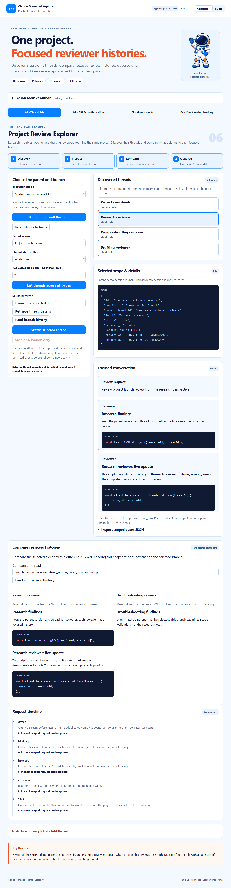
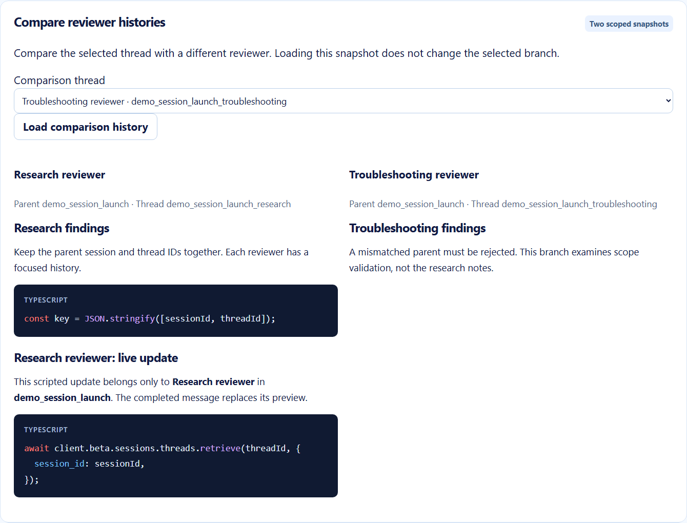
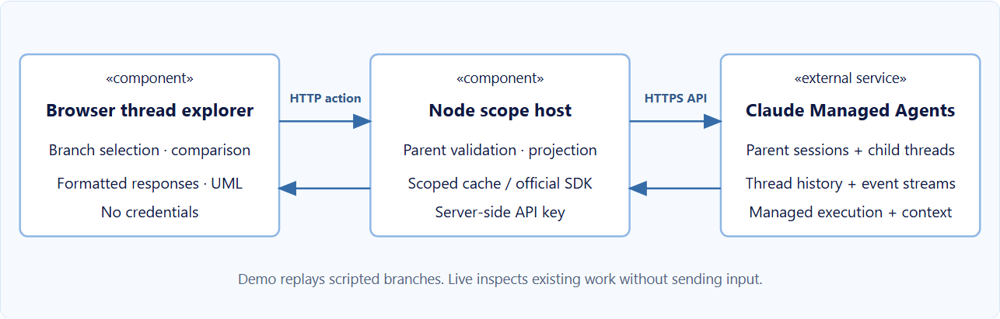

# Lesson 06 · Project Review Explorer

A practical companion to **Lesson 6: Threads and Thread Events**, by Luis Coco Enríquez. Discover a project session’s primary and child threads, compare reviewer histories, watch branch-specific events, and archive a completed child deliberately.

Live operations use **Claude Managed Agents through the official Anthropic SDK**. The UI uses TypeScript, Vite, sanitized rich text, and highlight.js. There is no local Claude Agent SDK or alternate AI provider.



## Run locally

Requires Node 24 (see `.nvmrc`).

```powershell
npm ci
npm run dev
```

Open **http://127.0.0.1:4326**. Click **Run guided walkthrough**. Demo provides two scripted project reviews with a primary coordinator and research, troubleshooting, and drafting children. It performs no cloud calls or managed execution. **Reset demo fixtures** restores those examples after an archival exercise and never touches live data.

Optional live inspection:

```powershell
Copy-Item .env.example .env
# Set ANTHROPIC_API_KEY and MANAGED_SESSION_ID
npm run dev
```

Restart Node after editing `.env`. Use an existing session from managed multiagent work or a workflow run to see children. A simple session may show only its primary thread. The thread API does not expose manual create/delete methods; this explorer does not invent them or send branch messages.

Live reads and observation start no new model work. Existing work may continue consuming usage. Archival deliberately changes the selected child. The server accepts only the configured live parent and threads discovered under it; credentials remain on Node.

If the port is occupied, use `$env:PORT="4336"` before starting and open that port instead.

## Student journey

1. Choose the parent session, status filter, and requested page size.
2. List all cursor pages. Even page size one discovers every matching thread.
3. Identify the primary thread by `parent_thread_id: null`.
4. Select a reviewer and retrieve its details and persisted events.
5. Compare another reviewer’s history without changing the selected scope.
6. Watch the selected thread: stream first, history second, then deduplicate buffered complete IDs.
7. Observe text previews being replaced by the complete message. A branch’s idle reason is separate from parent or sibling completion.
8. Close observation, then optionally archive an idle child using `ARCHIVE threadId`.

The scripted demo replays new branch events during Watch. Live Watch only subscribes to actual future activity; it sends no input and may wait without output if the branch is idle. Stop closes the local stream only and sends no interrupt. Reopening recovers persisted history before following new activity. The observer also closes after 90 seconds; managed execution is unaffected.

## Scope and lifecycle

Every request, view, and comparison keeps **session ID + thread ID** together. The server verifies returned IDs match the requested scope. Labels come from the thread’s agent information; they are not resource identifiers.

Archive is terminal and the API requires an idle thread. This app additionally protects the primary thread and all workflow-run threads; those conservative guards are application rules. The workflow service manages run-thread lifecycle, and open runs impose API restrictions. Running threads must not be archived through this inspector. The walkthrough never archives automatically.

Archived history stays inspectable. The app offers no delete action. It never sends prompts, tool results, approvals, or `user.interrupt`.

## Teaching structure

The approved pale-blue course layout, astronaut, four tabs, large typography, and Comfortable/Larger controls continue from earlier lessons. The application includes 12 expandable API/parameter cards with colored TypeScript, an eight-step selectable UML guide, comparison snapshots, request traces, formatted model content, and a six-question quiz.





The current SDK supports `statuses` and cursor pagination on thread list. Thread event list accepts parent scope and pagination; it does not expose the slide-era order/filter variants. Every API card follows the installed signatures.

## Streaming and data

Watching opens a thread stream before reading history so events emitted during recovery are buffered. Complete event IDs are deduplicated within that scoped view. Message deltas accumulate by event ID and content index; final content replaces a preview. A preview without a final event is marked incomplete when observation closes or its model request ends. Thinking content is omitted; unknown activity remains inspectable.

Each scoped view holds a conversation projection and the latest 400 event envelopes. History reads follow pagination with a 10,000-event teaching limit. Use the SDK directly for larger exports. Views, registered pairs, and traces remain in memory and reset with Node; no credential or transcript is written to a local registry.

This is a single-instructor loopback application, without multi-user authentication or production hosting. Selecting another project clears the active pair and preserves separately keyed snapshots. It does not imply that thread history isolation is a security boundary between agents sharing a session’s resources.

## Validate and inspect

```powershell
npm run check
npx playwright install chromium
npm run test:e2e
```

Domain/SDK tests exercise pagination, scope mismatch rejection, independent histories, archival guards, preview reconciliation, observer closure/timeout, buffered deduplication, thinking redaction, and exact SDK paths and beta headers. Browser journeys cover desktop/mobile walkthroughs, comparison, parent changes, lifecycle controls, every colored API card, UML, keyboard tabs, quiz, and larger text. Test credentials and HTTP responses are mock-only; live account execution is not validated.

```powershell
npm run build
npm start
# Optional: inspect and observe an existing live child, no archival or input:
npm run example
```

`src/examples/thread-events.ts` lists threads, retrieves an active child, opens its stream, and reads history before following live activity. Ctrl+C closes observation without interrupting managed execution.

## Source layout

- `src/server`: loopback HTTP/SSE host, live/demo adapters, scope validation, and archival guards.
- `src/shared`: lesson cards, quiz, scope types, and the shared event projection.
- `src/client`: accessible teaching UI, SSE decoding, formatting, highlighting, and native SVG UML.
- `src/examples`: standalone official SDK inspection example.
- `test`: domain/SDK checks and desktop/mobile learner journeys.
- `docs`: instructor guidance, visual notes, validation, and screenshots from the actual built demo.

SDK 1.6.0 is pinned; managed methods automatically send `managed-agents-2026-04-01`. Upgrade SDK and API assumptions together.

Official references: [Session threads](https://platform.claude.com/docs/en/managed-agents/session-threads), [Thread API](https://platform.claude.com/docs/en/api/beta/sessions/threads), [Event deltas](https://platform.claude.com/docs/en/managed-agents/event-deltas). Visual references and MIT asset attribution: [NOTICE](NOTICE).
